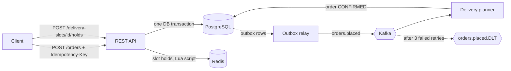

# Grocery Order Fulfillment Service

[](https://github.com/YOUR_USER/grocery-order-fulfillment-service/actions)

A backend service for an online grocery store: it takes checkouts, reserves stock **without ever overselling**, manages **delivery slot capacity** and streams order events to downstream consumers.

Built to explore the correctness problems a high-traffic grocery shop faces: many customers fighting for the last carton of milk, or the last seat in the 18:00 delivery window. It is a portfolio project, not a copy of any real company's system.

**Stack:** Java 21 · Spring Boot 3.3 · PostgreSQL · Redis · Kafka · Flyway · Testcontainers · Docker Compose · springdoc-openapi

## Run it

```bash
make up            # app + Postgres + Redis + Kafka, one command (needs Docker)
```

- Swagger UI: <http://localhost:8080/swagger-ui.html>
- Health: <http://localhost:8080/actuator/health>

`make test` runs the full suite (Testcontainers starts real Postgres, Kafka and Redis). `make run` starts only the infrastructure in Docker and the app on your machine with readable logs.

## Architecture



**Checkout (`OrderService.place`)** runs in a single Postgres transaction:

1. Replay check by `Idempotency-Key`.
2. For each SKU (sorted): atomic `UPDATE ... SET stock = stock - :qty WHERE stock >= :qty`.
3. Atomic `UPDATE ... SET booked = booked + 1 WHERE booked < capacity` on the delivery slot.
4. Insert the order and an `outbox_event` row.

Any failure rolls back everything, so there are no half-reserved baskets.

## Design decisions

| Problem | Decision | Why |
|---|---|---|
| Overselling under concurrency | Conditional `UPDATE` instead of read-then-write | The row lock serialises writers and the `WHERE` clause is the guard: no lost updates, no distributed lock. A `CHECK (stock >= 0)` constraint is the backstop. |
| Deadlocks between baskets | Process SKUs in sorted order | Concurrent orders always lock rows in the same order. |
| Client retries / double submits | `Idempotency-Key` header + `UNIQUE` column | A replay returns the original order (200 instead of 201) and does not reserve stock twice. |
| Dual-write problem (DB + Kafka) | Transactional outbox + relay (`FOR UPDATE SKIP LOCKED`) | An order and its event are committed atomically; multiple instances can relay without duplicating work. |
| Duplicate events | Idempotent consumer (`CustomerOrder.confirm()`) | Delivery is at-least-once, so handling must tolerate repeats. |
| Poison messages | Retry 3x, then `orders.placed.DLT` | One bad record cannot block a partition. |
| "Reserve my slot while I shop" | Redis sorted set + atomic Lua script, TTL 10 min | Fast, self-expiring holds. Postgres stays the source of truth at checkout, so Redis loss cannot cause overbooking. |
| Errors | RFC 7807 `ProblemDetail` for everything | Consistent `application/problem+json`, including Spring's own validation errors. |
| Observability | JSON logs (Logstash encoder), `orderId` in MDC, Actuator health incl. DB and Redis | Ready for a log pipeline; `SPRING_PROFILES_ACTIVE=plain` for readable local logs. |

## Try it

```bash
# 1. Pick a slot (seeded for the next 3 days) and a product
DATE=$(date -d tomorrow +%F 2>/dev/null || date -v+1d +%F)
curl -s "localhost:8080/api/v1/delivery-slots?date=$DATE" | head -c 400
curl -s localhost:8080/api/v1/products

# 2. (optional) hold the slot while shopping
curl -s -X POST localhost:8080/api/v1/delivery-slots/1/holds \
  -H 'Content-Type: application/json' -d '{"customerId":"alice"}'

# 3. Check out
curl -s -X POST localhost:8080/api/v1/orders \
  -H 'Content-Type: application/json' -H 'Idempotency-Key: demo-1' \
  -d '{"customerId":"alice","slotId":1,"items":[{"sku":"MILK-1L","quantity":2}]}'

# 4. A moment later the order is CONFIRMED by the Kafka consumer
curl -s localhost:8080/api/v1/orders/<id-from-step-3>
```

Things to try: repeat step 3 with the same key (idempotent replay); order 6 × `COFFEE-500G` (only 5 in stock, so you get a 409 problem response); fill a slot's 5 places and watch the 6th order fail.

## Testing

Integration tests run against real infrastructure with Testcontainers, not mocks:

- **40 threads, 10 items in stock:** exactly 10 orders succeed and stock ends at 0.
- **20 threads, slot with 3 places:** exactly 3 succeed, and stock of the rejected orders is rolled back.
- **Idempotent replay:** same key → same order, stock decremented once.
- **End to end:** place order → outbox → Kafka → consumer → status `CONFIRMED`.
- **Slot holds:** capped at free capacity, idempotent per customer, releasable.
- **API contract:** 201 + `Location`, 409 and 400 as `application/problem+json`, health is `UP`.

## Known trade-offs and next steps

- Orders can't be cancelled yet; that would need stock and slot compensation plus an `OrderCancelled` event.
- The outbox relay polls every 500 ms; Debezium/CDC would reduce latency and polling load.
- Holds are advisory: checkout does not require one, and other customers' holds are not counted against capacity at checkout.
- Replaying an idempotency key with a *different* body currently returns the original order; a request hash would let it return 422.
- No authentication or rate limiting (would sit at the gateway); no metrics registry yet (Micrometer + Prometheus is the obvious addition).
